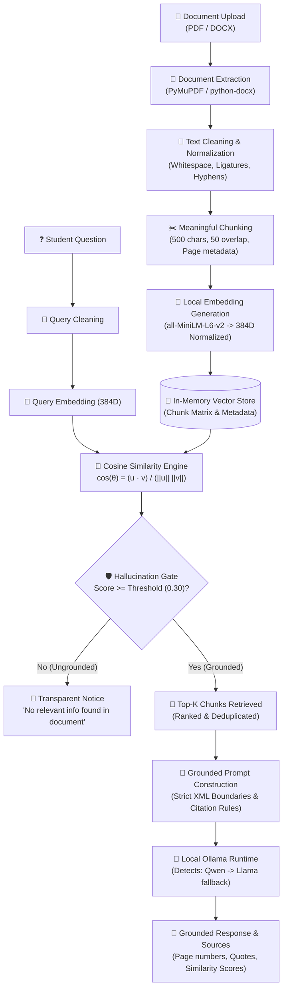

# 🎓 Local RAG Workshop: Chat with Documents
### *A Production-Grade, 100% Offline Retrieval-Augmented Generation Application for College AI Workshops*

[](https://python.org)
[](https://streamlit.io)
[](https://huggingface.co/sentence-transformers/all-MiniLM-L6-v2)
[](https://ollama.com)
[](LICENSE)

---

## 📌 1. Project Objective & Conceptual Overview

This project is a complete, beginner-friendly, and mathematically transparent **Local Retrieval-Augmented Generation (RAG)** application designed for college technical workshops, university AI labs, and student hackathons.

### 🚫 Workshop Principles & Constraints:
- **No Paid APIs:** Zero reliance on OpenAI, Google Gemini, OpenRouter, or Anthropic.
- **No API Keys:** Runs completely offline without credit card registration or rate limits.
- **100% Local Inference:** Embeddings are generated locally via Sentence Transformers; generation is executed locally via **Ollama**.
- **Model Policy:**
  - ⚡ **Primary:** **Qwen** (e.g. `qwen2.5:1.5b` or `qwen2.5:3b`)
  - 🔄 **Fallback:** **Llama** (e.g. `llama3.2:1b` or `llama3.2:3b`)
  - 🛡️ **Graceful Handling:** If neither model is installed, the application presents copy-paste installation commands rather than crashing.
- **Laptop-Friendly:** Optimized to run comfortably on student laptops with 8 GB RAM and standard multi-core CPUs without requiring dedicated GPUs.

---

## 🧱 2. System Architecture & Conceptual Pipeline



---

## 📂 3. Modular Codebase Structure

```text
rag_workshop/
│
├── app.py                      # Main Streamlit interactive workshop application
├── requirements.txt            # Lightweight Python dependencies
├── README.md                   # Comprehensive guide and workshop curriculum
├── .gitignore                  # Git tracking rules
│
├── core/                       # Core RAG Engineering Modules
│   ├── __init__.py             # Exports public pipeline interfaces
│   ├── document_loader.py      # PyMuPDF (fitz) & python-docx extractors with page tracking
│   ├── text_cleaner.py         # Ligature, hyphenation, and control-character sanitization
│   ├── chunker.py              # Recursive sliding-window chunker with metadata retention
│   ├── embeddings.py           # Sentence Transformers (all-MiniLM-L6-v2) singleton
│   ├── retriever.py            # Cosine similarity vector search & Top-K ranking
│   ├── ollama_client.py        # Lightweight HTTP client for local Ollama daemon
│   ├── model_selector.py       # Runtime model resolver (Qwen -> Llama -> setup alert)
│   └── rag_pipeline.py         # End-to-end RAG orchestrator with hallucination gating
│
├── ui/                         # Frontend & Styling Components
│   ├── __init__.py             # Exports UI components
│   ├── styles.py               # Custom high-contrast CSS, badges, and card styling
│   └── components.py           # Header status pills, metrics, & transparency drawer
│
├── data/
│   ├── uploads/                # Temporary directory for student uploaded documents
│   └── sample_docs/            # Realistic college sample documents
│       ├── generate_samples.py # Script to generate test PDF & DOCX files
│       ├── college_workshop_syllabus.pdf
│       └── ai_engineering_handbook.docx
│
└── tests/                      # PyTest Unit & Integration Test Suite
    ├── __init__.py
    ├── test_document_loader.py # Tests PDF/DOCX parsing and error handling
    ├── test_text_cleaner.py    # Tests text normalization and hyphenation
    ├── test_chunking.py        # Tests chunk sizing, overlap, and page metadata
    ├── test_embeddings.py      # Tests 384D vector dimensions and L2-norm
    ├── test_retrieval.py       # Tests cosine similarity math and Top-K ranking
    └── test_model_selection.py # Tests Qwen priority, Llama fallback, and offline handling
```

---

## ⚙️ 4. Quickstart Setup Guide

### Step 1: Clone or Navigate to the Workshop Folder
```bash
cd rag_workshop
```

### Step 2: Create and Activate a Python Virtual Environment
```bash
# Windows (PowerShell)
python -m venv venv
.\venv\Scripts\Activate.ps1

# macOS / Linux
python3 -m venv venv
source venv/bin/activate
```

### Step 3: Install Required Dependencies
```bash
python -m pip install -r requirements.txt
```

---

## 🦙 5. Ollama Installation & Model Setup

Ollama runs open-weight LLMs locally on your laptop without cloud dependencies.

### Step 1: Install Ollama
- **Windows:** Download and run `OllamaSetup.exe` from [https://ollama.com/download/windows](https://ollama.com/download/windows).
- **macOS:** Download the `.zip` or install via Homebrew: `brew install ollama`.
- **Linux:** Run: `curl -fsSL https://ollama.com/install.sh | sh`.

### Step 2: Pull the Recommended Workshop Models
Open your terminal and pull the primary Qwen model:
```bash
# Primary Workshop Model: Qwen 2.5 (1.5B or 3B parameters)
ollama pull qwen2.5:1.5b
```

*(Optional Fallback Model)* Pull Llama to test model switching and fallback:
```bash
# Fallback Workshop Model: Llama 3.2 (1B or 3B parameters)
ollama pull llama3.2:1b
```

### Step 3: Verify Installed Models
```bash
ollama list
```
You should see `qwen2.5:1.5b` (and/or `llama3.2:1b`) listed.

---

## 🚀 6. Launching the Application

Start the Streamlit application with:
```bash
python -m streamlit run app.py
```
Open your browser to: **`http://localhost:8501`**

---

## 📐 7. Deep-Dive Component Explanations

### 1. Document Extraction (`core/document_loader.py`)
- **PDF Extraction:** Uses **PyMuPDF (`pymupdf`)** for fast, native C-speed text extraction. It extracts text on a page-by-page basis, preserving `page_number` (1-indexed). It detects scanned image pages that lack extractable text and flags them with an educational warning.
- **DOCX Extraction:** Uses **`python-docx`** to extract text from paragraphs and table cells, segmenting long documents into logical sections.

### 2. Text Cleaning (`core/text_cleaner.py`)
Raw PDF text often contains typographic artifacts that degrade embedding quality:
- Replaces typographic ligatures (`fi` $\rightarrow$ `fi`, `fl` $\rightarrow$ `fl`).
- Reconstructs words broken across line breaks (`recon-\nstruction` $\rightarrow$ `reconstruction`).
- Strips non-printable ASCII control characters (`\x00` - `\x1f`).
- Collapses excessive blank lines to clean paragraph boundaries while preserving list formatting and formulas.

### 3. Meaningful Chunking (`core/chunker.py`)
Arbitrarily sending an entire 30-page PDF to an LLM overwhelms its context window and increases retrieval noise.
- Splits text into target **`chunk_size`** (default: 500 characters) with a configurable **`chunk_overlap`** (default: 50 characters).
- Splits recursively on natural language boundaries (paragraphs `\n\n`, sentence endings `. `, `? `, `! `, and words) to avoid chopping words in half.
- Attaches metadata to every chunk: `chunk_id`, `source_file`, `page_number`, `char_count`, and `word_count`.

### 4. Dense Embeddings (`core/embeddings.py`)
- Uses **`all-MiniLM-L6-v2`** from Sentence Transformers.
- **Why this model?** It is compact (~80 MB), fast on laptop CPUs, and maps text into a semantically dense **384-dimensional vector space**.
- **L2 Normalization:** All vectors are normalized so that their Euclidean length $\|\mathbf{v}\|_2 = 1.0$.

### 5. Cosine Similarity & Vector Mathematics (`core/retriever.py`)
Cosine similarity calculates the cosine of the angle $\theta$ between two vectors in $D$-dimensional space:

$$\text{Cosine Similarity}(\mathbf{u}, \mathbf{v}) = \cos(\theta) = \frac{\mathbf{u} \cdot \mathbf{v}}{\|\mathbf{u}\|_2 \|\mathbf{v}\|_2} = \frac{\sum_{i=1}^D u_i v_i}{\sqrt{\sum_{i=1}^D u_i^2} \sqrt{\sum_{i=1}^D v_i^2}}$$

**Educational Note:** Because our embeddings are already L2-normalized ($\|\mathbf{u}\|_2 = 1$ and $\|\mathbf{v}\|_2 = 1$), the denominator equals $1.0$, simplifying the formula directly to the inner dot product:

$$\text{Cosine Similarity}(\mathbf{u}, \mathbf{v}) = \mathbf{u} \cdot \mathbf{v} = \sum_{i=1}^{384} u_i v_i$$

This allows computing similarities across hundreds of chunks in a fraction of a millisecond using NumPy matrix multiplication (`np.dot(query, matrix.T)`).

### 6. Model Resolution & Fallback Logic (`core/model_selector.py`)
```text
detect_ollama_models()
  │
  ├──► Check installed models for "qwen"
  │      └──► IF found: Select Qwen as Primary (is_fallback = False)
  │
  ├──► ELSE check installed models for "llama"
  │      └──► IF found: Select Llama as Fallback (is_fallback = True)
  │
  ├──► ELSE IF other models exist (e.g., mistral, gemma)
  │      └──► Display notice and use available model
  │
  └──► ELSE (Ollama offline or 0 models)
         └──► Display clean copy-paste terminal commands without crashing
```

### 7. Hallucination Control & Prompt Injection Defense (`core/rag_pipeline.py`)
- **Similarity Threshold Gate:** If the user asks an irrelevant or ungrounded question (e.g. asking about celebrity gossip when analyzing a CS syllabus), the highest similarity score will fail the threshold ($\text{score} < 0.30$). The pipeline halts immediately and notifies the student without invoking the LLM.
- **Prompt Isolation:** Retrieved text is enclosed within `<retrieved_context>` XML tags. The system prompt instructs the LLM to treat this context strictly as passive data, preventing prompt-injection attacks from malicious document text.
- **Strict Citation Rules:** The LLM is commanded: *"Base your answer EXCLUSIVELY on the retrieved document context. If not found, say 'I could not find information about this in the uploaded document.' Never invent facts."*

---

## 🧪 8. Workshop Live Demonstration Script (Teaching Flow)

Follow this 8-step walkthrough during a live workshop presentation:

| Part | Activity | Teaching Point |
|---|---|---|
| **Part 1** | Upload `data/sample_docs/college_workshop_syllabus.pdf` in the sidebar and click **Index Document**. | Show document statistics (2 pages, ~3,500 chars, ~8 chunks generated). Explain how text is extracted. |
| **Part 2** | Open **Tab 2 (Document & Chunk Inspector)**. | Show how the PDF is divided into 500-character chunks with 50-character overlap. Explain why sliding windows prevent losing context across chunk boundaries. |
| **Part 3** | Show the **Embedding Vector Preview** in Tab 2. | Explain that each text chunk is represented as an array of 384 floating-point numbers encoding its semantic meaning. |
| **Part 4** | In **Tab 1 (Chat)**, ask: *"What are the eligibility requirements mentioned in this document?"* | Watch the retrieval process. Point out the speed (< 5ms retrieval time on CPU). |
| **Part 5** | Expand the **🔬 Retrieval Transparency Panel** under the answer. | Show Chunk #1 with similarity score ~0.70+. Explain how cosine similarity matched the query to Page 1 of the syllabus. |
| **Part 6** | Read the assistant's answer. | Note how the model cited `[Source: college_workshop_syllabus.pdf, Page 1]` and listed prerequisites (Python 3.10+, Linear Algebra, 8 GB RAM). |
| **Part 7** | Switch the active model in the sidebar from **Qwen** to **Llama** (or test fallback). | Ask the same question and compare response styles, demonstrating local model portability. |
| **Part 8** | Ask an ungrounded question: *"What is the recipe for chocolate chip cookies?"* | Show **Hallucination Control** in action: the system alerts that the similarity score was below the 0.30 threshold and refuses to hallucinate! |

---

## 💡 9. Example Questions for Testing

### Grounded Questions (Expected to retrieve and answer accurately):
1. *"What are the eligibility requirements and prerequisites for this course?"*
   - **Grounding:** Found on Page 1 (3rd/4th year B.Tech, Python 3.10+, Linear Algebra).
2. *"What is the passing score and grading breakdown?"*
   - **Grounding:** Found on Page 2 (Pass score: 65%; Lab: 20%, Quiz: 30%, Capstone: 50%).
3. *"What is the attendance requirement and late submission penalty?"*
   - **Grounding:** Found on Page 2 (80% attendance; 10% penalty per day up to 3 days).
4. *"Who is the workshop lead and when are office hours?"*
   - **Grounding:** Found on Page 2 (Dr. A. Vance; Tuesdays & Thursdays 4:00 PM - 5:30 PM).

### Out-of-Domain Questions (Testing Hallucination Gate):
1. *"Who won the 2024 FIFA World Cup?"*
   - **Expected Result:** Blocked by similarity threshold; informs student that no relevant document content was found.
2. *"How do I bake a sourdough bread?"*
   - **Expected Result:** Blocked by similarity threshold.

---

## 🛠️ 10. Troubleshooting Guide

| Issue | Cause | Solution |
|---|---|---|
| **Ollama Offline (Red Badge)** | The Ollama background process is not running. | Run `ollama serve` in a new terminal window or launch Ollama from your Applications / Start Menu. |
| **No Models Installed (Yellow Badge)** | Ollama is running, but no models have been downloaded. | Run `ollama pull qwen2.5:1.5b` (primary) or `ollama pull llama3.2:1b` (fallback). |
| **Generation Timeout** | Selected model is too large for student laptop hardware. | Switch to a smaller quantized model like `qwen2.5:1.5b` or `llama3.2:1b`. |
| **Scanned / Image-Only PDF Warning** | The PDF contains scanned raster images without an embedded text layer. | Use an OCR tool or upload text-based PDFs/DOCX files. |
| **Model Hallucinates on Weak Data** | Similarity threshold is set too low (e.g. 0.05). | Increase the **Similarity Threshold** slider in the sidebar to `0.35` or `0.40`. |

---

## 🧪 11. Running the Automated Test Suite

The project includes unit and integration tests covering extraction, cleaning, chunking, embeddings, cosine math, Top-K retrieval, and model fallback logic:

```bash
# Run all tests
python -m pytest -v

# Run only retrieval & cosine similarity tests
python -m pytest tests/test_retrieval.py -v

# Run only model selection & fallback tests
python -m pytest tests/test_model_selection.py -v
```

---

## 📄 License
This educational project is released under the **MIT License**. Free for university classrooms, student workshops, and educational demonstrations.
